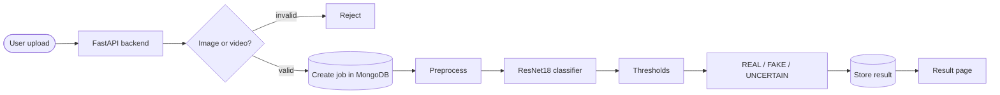

# Deepfake Detection with ResNet18 + MTCNN

An end-to-end deepfake detector for images and videos. Upload a file, a background job processes it, and the result page shows a probability score and one of three labels: **REAL**, **FAKE** or **UNCERTAIN**.

Built as a **B.Tech final-year Computer Science & Engineering project** at GLA University, Mathura. A paper on this work has been submitted to a conference; no decision yet.

<!-- EDIT: add 2-3 badges only for what is true, e.g. Python, PyTorch, FastAPI -->

## Why three labels?

Most detectors force every input into real or fake. This one returns **UNCERTAIN** when the probability falls between two thresholds, so borderline or low-quality media is flagged instead of guessed.

| Probability of fake (p) | Label |
|---|---|
| p < 0.40 | REAL |
| 0.40 ≤ p ≤ 0.60 | UNCERTAIN |
| p > 0.60 | FAKE |

Both thresholds are set in `backend/app/config.py` (`LOWER_THRESHOLD`, `UPPER_THRESHOLD`).

## Pipeline



**Preprocessing**
1. Read with OpenCV; for video, extract up to 64 frames
2. Detect faces with MTCNN (thresholds `[0.6, 0.7, 0.7]`, min face size 20), crop the largest face with 20% padding
3. Improve contrast with CLAHE
4. Resize to 224×224 and apply ImageNet normalization

**Classification**
- Pretrained ResNet18 (transfer learning), classifier head: Dropout(0.5) + Linear(512 → 1)
- Sigmoid on the single logit gives the probability of fake

**Videos**
- No temporal model. Each frame is scored on its own, the mean of the frame scores is the video score, and the same thresholds apply.

## Training

| Item | Setting |
|---|---|
| Loss | `BCEWithLogitsLoss` |
| Optimizer | Adam, weight decay 1e-4 |
| Scheduler | ReduceLROnPlateau (factor 0.5, patience 1) |
| Augmentation | Horizontal flip, brightness, gamma, small color changes |
| Checkpointing | Best model saved by validation results |
| Labels | REAL = 0, FAKE = 1 |

**Dataset.** The project does not ship with a dataset or use a fixed public benchmark. It trains on a custom dataset laid out like this (see `dataset/README.md`):

```
dataset/
  train/
    real/
    fake/
  val/
    real/
    fake/
```

Training uses `dataset/train`, evaluation uses `dataset/val`.

**Data used for the reported results:** <!-- EDIT: where the real and fake images came from (public dataset name, or how you collected them), and the number of images in each folder -->

## Results

Measured by `training/evaluate.py` on the validation set (binary classification, not macro-averaged):

| Precision | Accuracy | Recall | F1 score |
|---|---|---|---|
| 97.28% | 97.46% | 97.91% | 97.59% |

<!-- EDIT: re-run `python evaluate.py` and paste all four numbers from one run. F1 above is computed from the precision and recall; if your run prints something different, use the printed values. -->

<!-- EDIT: add your training and validation graphs, e.g.  -->

**Read these numbers with care.** The validation set was also used to pick the best checkpoint and to drive the learning-rate scheduler, and there is no separate held-out test set, so the scores are probably optimistic. They have not been checked on other datasets or on deepfakes from unseen generators.

## Screenshots

<!-- EDIT: add after you capture them (docs/screenshots/):


-->

## Tech stack

Python · PyTorch · torchvision · MTCNN · OpenCV · NumPy · FastAPI · MongoDB · <!-- EDIT: frontend framework, e.g. React + Vite -->

## Project structure

```
backend/     FastAPI app (app/main.py, app/config.py)
frontend/    Upload page and result page
training/    train.py, evaluate.py
dataset/     Your data (not included), layout described in dataset/README.md
```

## Run locally

**Requirements:** Python, Node.js, and MongoDB running at `mongodb://localhost:27017` (database `deepfake_detection`, collection `jobs`).

**1. Backend**
```powershell
cd backend
.\.venv\Scripts\Activate.ps1
uvicorn app.main:app --reload --host 127.0.0.1 --port 8000
```
FastAPI's interactive API docs are at `http://127.0.0.1:8000/docs`.

**2. Frontend**
```powershell
cd frontend
npm install
npm run dev
```
Open the address that `npm run dev` prints, upload an image or video, and wait for the job to finish.

**3. Train your own model**
```powershell
cd training
python train.py --epochs 10 --batch_size 16 --lr 0.0001
python evaluate.py
```

<!-- EDIT: say where trained weights are saved, and whether they are included in the repo or must be trained first -->

## Limitations

- Results come from one custom dataset; accuracy on other datasets is unknown. Deepfake detectors often drop on unseen generators.
- No separate test set, so the reported scores are validation scores.
- Averaging frame scores can hide a video where only a few frames are manipulated.
- Heavy compression, very small faces, or no detectable face reduce reliability.
- It is a baseline, not a forensic tool, and should not be the only evidence for a decision.

## Future work

- Evaluate on public benchmarks (FaceForensics++, Celeb-DF, DFDC) with a held-out test set
- Audio-visual consistency checks
- Multi-scale texture discriminators
- Facial action unit features
- A temporal model for video instead of simple averaging

## Authors

Pragati Srivastava, Racheet Saraswat, Shivendra Pandey, Sarthak Patel, Aman Saxena
Department of Computer Science and Engineering, GLA University, Mathura

## License

<!-- EDIT: add a license, e.g. MIT, and a LICENSE file -->
